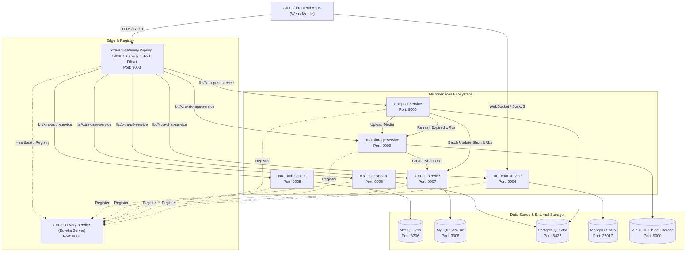

# Xtra Microservices Architecture

## Executive Summary
**Xtra** is a cloud-native, distributed social platform built with **Java 17**, **Spring Boot 3.4/3.5**, and **Spring Cloud 2024/2025**. The platform decouples concerns into specialized microservices responsible for traffic routing, authentication & authorization, real-time messaging, content publishing, file persistence, URL shortening, and user profile management.

The architecture leverages polyglot persistence (**MySQL**, **PostgreSQL**, **MongoDB**, and **MinIO S3 Object Storage**) to optimize data structures for relational transactions, binary storage, and low-latency document streaming.

---

## Architecture Topology



---

## Service Catalog & Port Allocation

| Directory | Service Name | Spring Boot | Port | Primary Database | Key Responsibilities |
| :--- | :--- | :--- | :--- | :--- | :--- |
| [`xtra-discovery-service`](file:///c:/Projects/Spring/xtra-discovery-service/README.md) | `xtra-discovery-server` | 3.4.1 | **9002** | In-Memory Registry | Eureka service registry, heartbeat tracking, dashboard |
| [`xtra-api-gateway`](file:///c:/Projects/Spring/xtra-api-gateway/README.md) | `xtra-api-gateway` | 3.4.1 | **9003** | Stateless | Reverse proxy, dynamic Eureka routing, JWT filter, logging |
| [`xtra-chat-service`](file:///c:/Projects/Spring/xtra-chat-service/README.md) | `xtra-chat-service` | 3.4.0 | **9004** | MongoDB | Real-time chat via WebSocket (STOMP), message & room persistence |
| [`xtra-auth-service`](file:///c:/Projects/Spring/xtra-auth-service/README.md) | `xtra-auth-service` | 3.4.0 | **9005** | MySQL (`xtra`) | Registration, login, Google OAuth2, JWT issuance, roles |
| [`xtra-post-service`](file:///c:/Projects/Spring/xtra-post-service/README.md) | `xtra-post-service` | 3.4.1 | **9006** | PostgreSQL (`xtra`) | Posts, captions, hashtags, scheduled URL regeneration cron |
| [`xtra-url-service`](file:///c:/Projects/Spring/xtra-url-service/README.md) | `xtra-url-service` | 3.4.4 | **9007** | MySQL (`xtra_url`) | Base62 short URL creation, HTTP 302 redirection |
| [`xtra-user-service`](file:///c:/Projects/Spring/xtra-user-service/README.md) | `xtra-user-service` | 3.5.0 | **9008** | PostgreSQL (`xtra`) | User profiles, handles (`@username`), biographical information |
| [`xtra-storage-service`](file:///c:/Projects/Spring/xtra-storage-service/README.md) | `xtra-storage-service` | 3.5.3 | **9009** | MinIO + PostgreSQL | MinIO file storage, 7-day presigned URL generation, URL service link |

---

## API Gateway Routing Matrix

All external client traffic should target the API Gateway on port `9003`. The gateway proxies requests based on prefix predicates:

```
Client Request -> http://localhost:9003/api/v1/xtra/{module}/**
```

| Route Predicate | Target Service | Purpose |
| :--- | :--- | :--- |
| `/api/v1/xtra/auth/**` | `lb://xtra-auth-service` | Authentication, login, token refresh, Google OAuth |
| `/api/v1/xtra/user/**` | `lb://xtra-user-service` | Profile management, update, usernames |
| `/api/v1/xtra/post/**` | `lb://xtra-post-service` | Post creation, feed retrieval, post deletion |
| `/api/v1/xtra/chat/**` | `lb://xtra-chat-service` | Chat room CRUD and history queries |
| `/api/v1/xtra/storage/**` | `lb://xtra-storage-service` | Direct multipart file uploads and presigned asset URLs |
| `/api/v1/xtra/url/**` | `lb://xtra-url-service` | Short URL creation, inspection, and update |

---

## Polyglot Persistence Architecture

The platform selects databases based on operational requirements:

```
┌────────────────────────────────────────────────────────┐
│                   Xtra Persistence Layer               │
├───────────────────┬────────────────────────────────────┤
│ MySQL (3306)      │ - xtra: User auth, credentials,    │
│                   │   roles, refresh tokens            │
│                   │ - xtra_url: Short URL mappings     │
├───────────────────┼────────────────────────────────────┤
│ PostgreSQL (5432) │ - xtra: User profiles, posts,      │
│                   │   captions, hashtags, media refs   │
├───────────────────┼────────────────────────────────────┤
│ MongoDB (27017)   │ - xtra: Chat rooms, chat details,  │
│                   │   high-throughput messaging history│
├───────────────────┼────────────────────────────────────┤
│ MinIO S3 (9000)   │ - testing: Posts and profile image │
│                   │   binary assets (images, videos)   │
└───────────────────┴────────────────────────────────────┘
```

---

## Infrastructure Prerequisites & Setup

Ensure the following infrastructure components are active prior to launching the microservices:

### 1. MySQL Server (`localhost:3306`)
```sql
CREATE DATABASE xtra;
CREATE DATABASE xtra_url;
```
*Default credentials: `root / root`*

### 2. PostgreSQL Server (`localhost:5432`)
```sql
CREATE DATABASE xtra;
```
*Default credentials: `admin / admin`*

### 3. MongoDB Server (`localhost:27017`)
- Database: `xtra`
- Default credentials: `admin / admin`

### 4. MinIO S3 Server (`localhost:9000`)
- Web Console: `http://localhost:9001`
- S3 Endpoint: `http://localhost:9000`
- Access Key: `admin`
- Secret Key: `m!n!02708@`
- Bucket Name: `testing`

---

## Recommended Service Startup Sequence

To ensure healthy peer discovery and route availability, start the services in this specific order:

1. **`xtra-discovery-service`** (`Port 9002`): Must be fully initialized so subsequent services can announce themselves.
2. **`xtra-url-service`** (`Port 9007`) & **`xtra-storage-service`** (`Port 9009`): Foundation services for asset link handling.
3. **`xtra-auth-service`** (`Port 9005`) & **`xtra-user-service`** (`Port 9008`): Identity and profile management.
4. **`xtra-post-service`** (`Port 9006`) & **`xtra-chat-service`** (`Port 9004`): Content creation and messaging.
5. **`xtra-api-gateway`** (`Port 9003`): Reverse proxy; starts routing once internal endpoints have appeared in Eureka.

---

## Common Development Commands

### Building All Projects
From the root workspace directory, run Gradle builds across each module:
```powershell
Get-ChildItem -Directory -Filter "xtra-*" | ForEach-Object {
    Write-Host "Building $($_.Name)..." -ForegroundColor Cyan
    Push-Location $_.FullName
    .\gradlew.bat clean build -x test
    Pop-Location
}
```

### Running an Individual Service
```powershell
cd xtra-discovery-service
.\gradlew.bat bootRun
```

